<h3 align="center">
   
  
  Custom <a href="https://zxvjaz.github.io/custom-homepage/">Homepage</a>
  
</h3>

  
  
  
  

  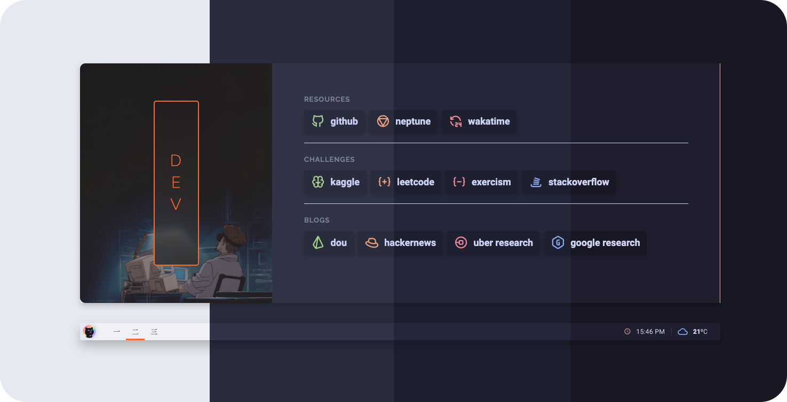

## 🪴 Overview

A Customisable homepage that uses the [**Catppuccin palettes**](https://catppuccin.com/palette). It is hosted on GitHub Pages. The page is based on [`catppuccin-startpage`](https://github.com/pivoshenko/catppuccin-startpage).

### 🎨 Supported Palettes

- Latte
- Frappé
- Macchiato
- Mocha

### ⭐ Features

- Automatic theme switching based on system settings (light/dark mode)
- Built-in GUI settings modal with live bookmarks and tabs editor
- Import & export configuration tools (JSON backup & sync)
- Customizable page title and favicon (browser tab + statusbar icon)
- Customizable animation playback speed for bookmarks and search (with 0x instant mode)
- Visual banner picker with previews for all 18 preset animations and custom image URLs
- Customisable startpage / bookmarks manager
- Search bar with multiple engines and quick command triggers
- Weather widget with location search combobox
- Clock widget with 12/24-hour format and multiple time zones support

## 🪵 Usage

> [!TIP]
> **Configuration Options**:
> - **Visual Settings Modal (GUI)**: Open the search bar by pressing <kbd>s</kbd>, type `:settings`, and hit <kbd>Enter</kbd> to launch the visual settings modal.
> - **Code Configuration (`userconfig.js`)**: Prefer code-first configuration? Read the dedicated [**`userconfig.js` Configuration Guide**](docs/userconfig-guide.md) for full instructions and examples on customizing themes, page title, favicon, animation speed, search engines, and bookmark tabs.
> - **Bookmark Icons**: You can find icons for your bookmarks using [`tabler-icons`](https://tabler.io/icons).

1. Open https://zxvjaz.github.io/custom-homepage/
2. Configure as you like and enjoy!

### As Homepage

- Click the menu button and select `Options/Preferences`
- Click the home panel
- Click the menu next to 'Homepage and new windows', choose to show custom URLs, and add your GitHub Pages link

### As New Tab

You can use different add-ons or extensions for this.

- If you use Firefox-based browsers: [Custom New Tab Page](https://addons.mozilla.org/en-US/firefox/addon/custom-new-tab-page/?src=search) and make sure to enable "Force links to open in the top frame (experimental)" in the extension's preferences page
- If you use Chromium-based browsers (Brave / Chrome): [Custom New Tab URL](https://chrome.google.com/webstore/detail/custom-new-tab-url/mmjbdbjnoablegbkcklggeknkfcjkjia)

## 🛠️ Development

For local viewing, run `python3 -m http.server 8000` from the repository root and open `http://localhost:8000`. note: you need python to do this.

### 🔎 Search

  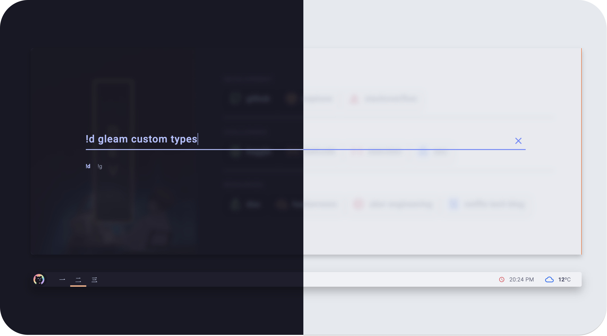

The search dialogue is wired to the search engines defined in the configuration. Press `s` to open it, then type a query, or a URL to jump straight there.

To pick an engine, prefix the query with its `!<id>`. The engines defined by default are:

- `!g`: Google
- `!d`: DuckDuckGo

You can also open the visual settings modal directly from search by typing `:settings` and pressing `Enter`.

## ⚙️ Settings & Customisation

  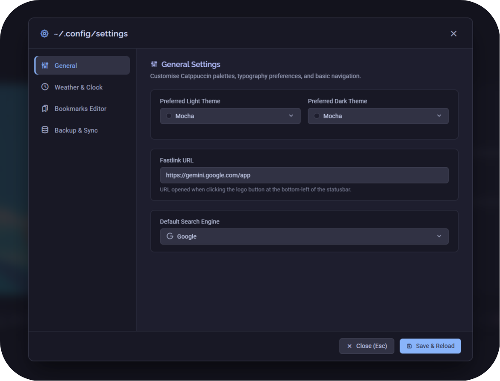

The startpage features a built-in visual configuration modal, allowing you to customise your setup directly in the browser without modifying code.

### Opening the Settings Modal

- Press <kbd>s</kbd> to open the search bar.
- Type `:settings` and press <kbd>Enter</kbd>.
- Press <kbd>Esc</kbd> or click outside the modal to close it.

### Configuration Sections

- **General**: Select your preferred light and dark Catppuccin flavour (Latte, Frappé, Macchiato, Mocha), set a custom Page Title and Favicon Image, adjust animation playback speed sliders for bookmarks and search (with 0x instant mode), set a fastlink URL, and choose your default search engine.
- **Weather & Clock**: Toggle the weather and clock widgets on or off, search for your city from a built-in global and regional database with aliases, configure temperature units (°C / °F) and OpenWeatherMap API key, and customise clock formatting or multiple time zones.
- **Bookmarks & Tabs**: Visually organise tabs, choose banner GIF animations from the built-in preset picker gallery (1-18) or custom image URLs, manage categories, and add or edit links with live Tabler icon previews and Catppuccin palette colour pickers.
- **Backup & Sync**: Export your configuration as a standalone `.json` backup file, import an existing JSON or `userconfig.js` file, or restore default settings with a single click.

> [!NOTE]
> Settings configured through the GUI take precedence and are stored in your browser's `localStorage`. For a complete guide on manual configuration via code, check out [**`docs/userconfig-guide.md`**](docs/userconfig-guide.md).

## 🖼️ Available Banners

| banner_01                                           | banner_02                                           | banner_03                                           | banner_04                                           |
| --------------------------------------------------- | --------------------------------------------------- | --------------------------------------------------- | --------------------------------------------------- |
|  |  | 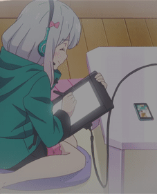 |  |

| banner_05                                           | banner_06                                           | banner_07                                           | banner_08                                           |
| --------------------------------------------------- | --------------------------------------------------- | --------------------------------------------------- | --------------------------------------------------- |
|  |  | 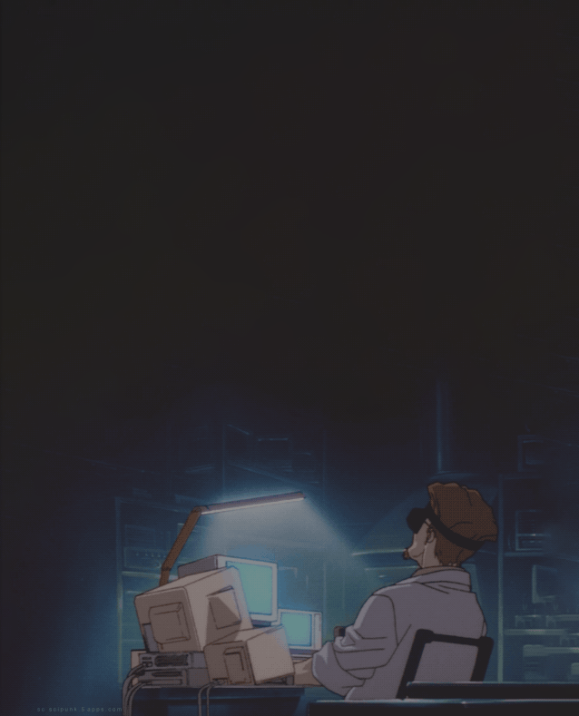 |  |

| banner_09                                           | banner_10                                           | banner_11                                           | banner_12                                           |
| --------------------------------------------------- | --------------------------------------------------- | --------------------------------------------------- | --------------------------------------------------- |
|  | 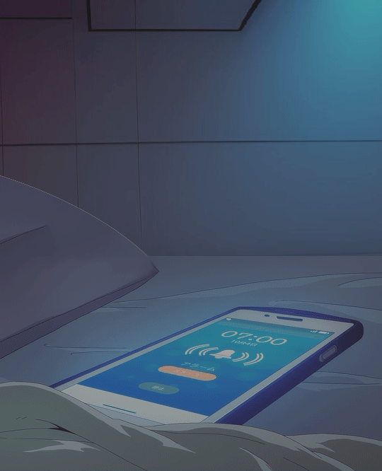 |  |  |

| banner_13                                           | banner_14                                           | banner_15                                           | banner_16                                           |
| --------------------------------------------------- | --------------------------------------------------- | --------------------------------------------------- | --------------------------------------------------- |
| 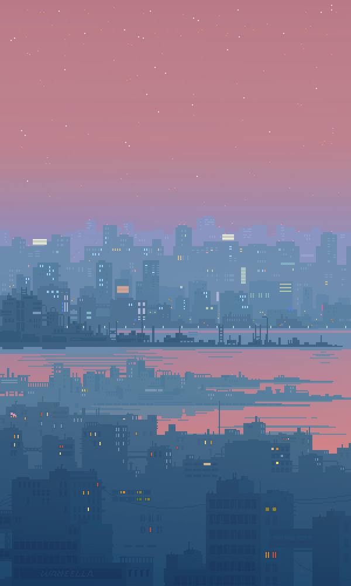 | 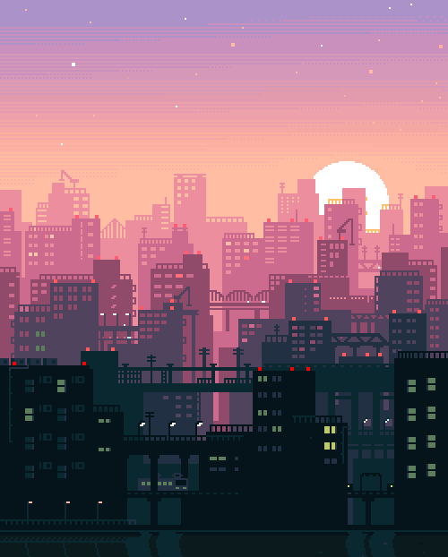 | 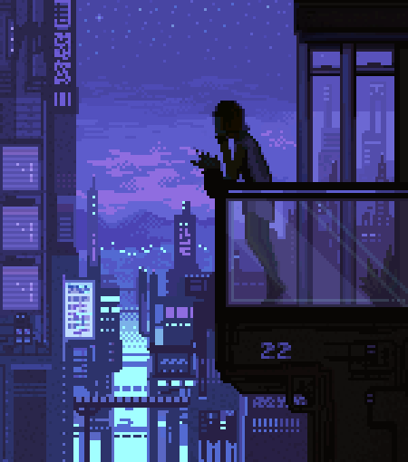 | 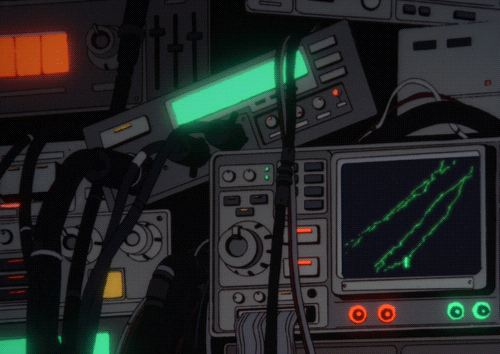 |

| banner_17                                           | banner_18                                           |
| --------------------------------------------------- | --------------------------------------------------- |
| 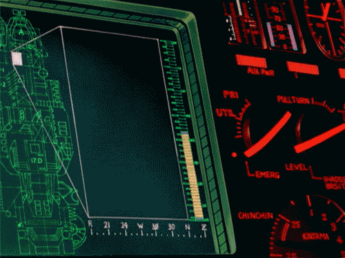 |  |
